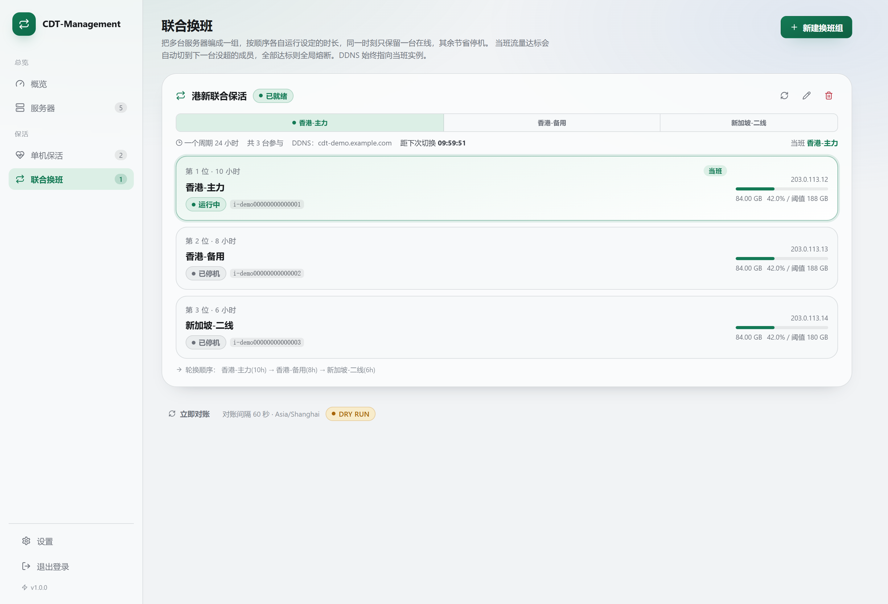
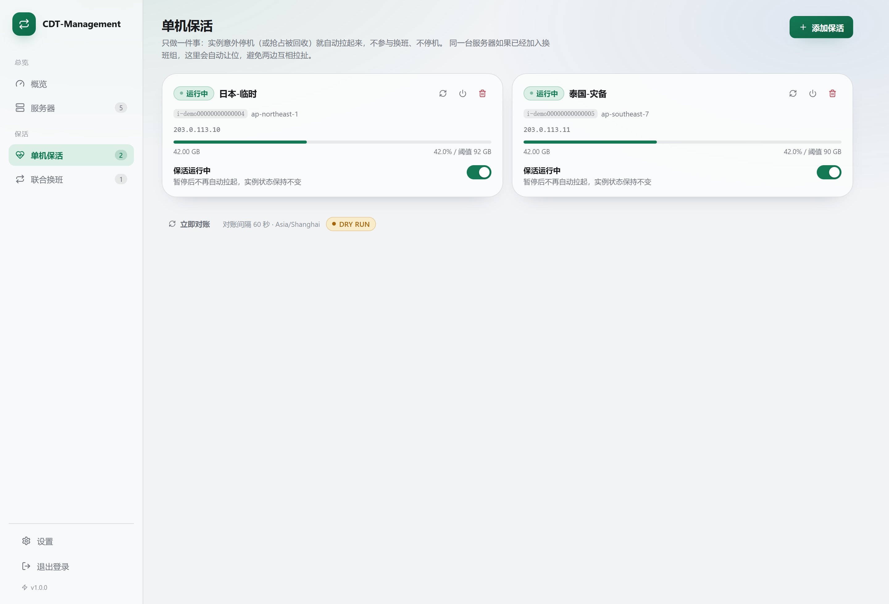
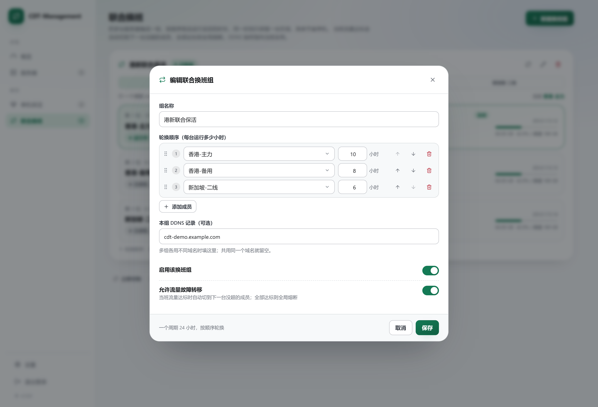
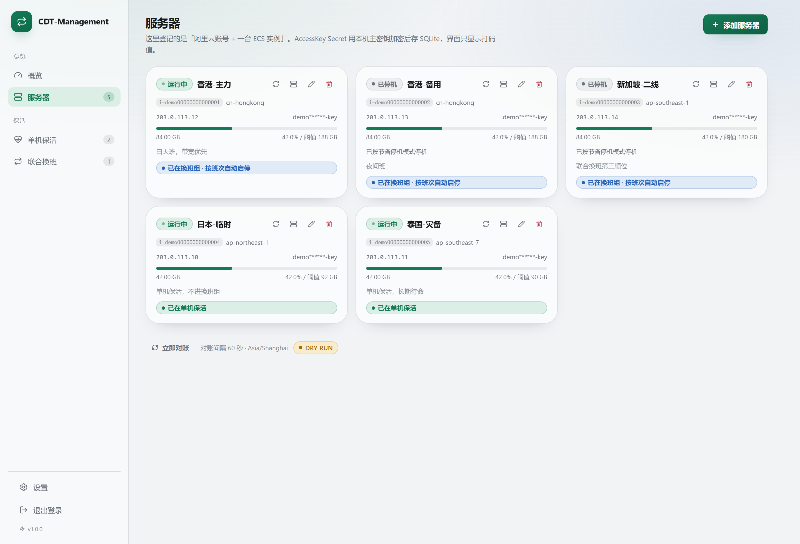
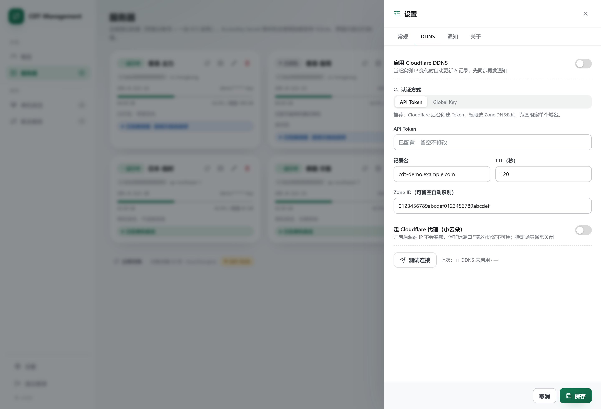
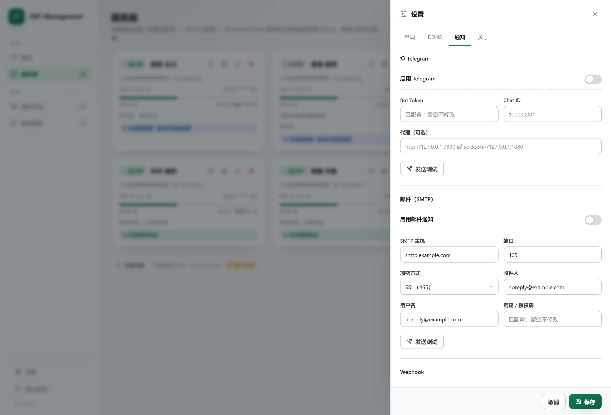
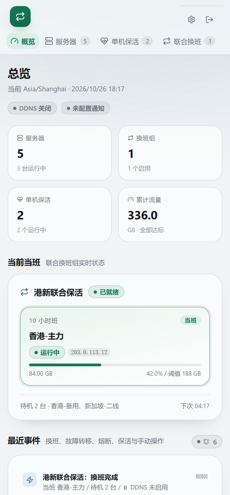
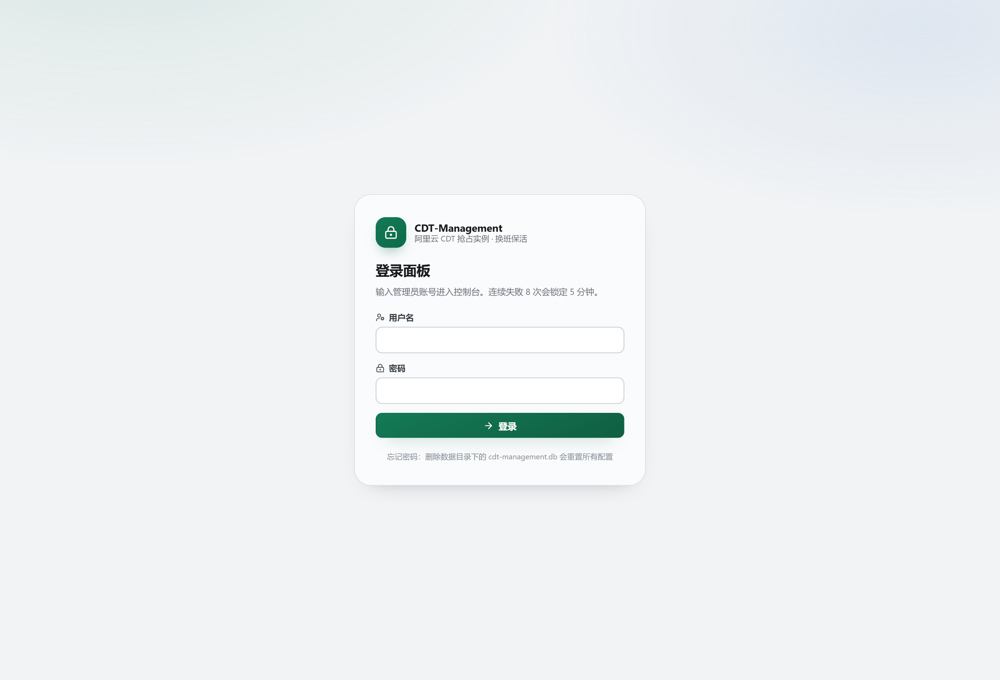
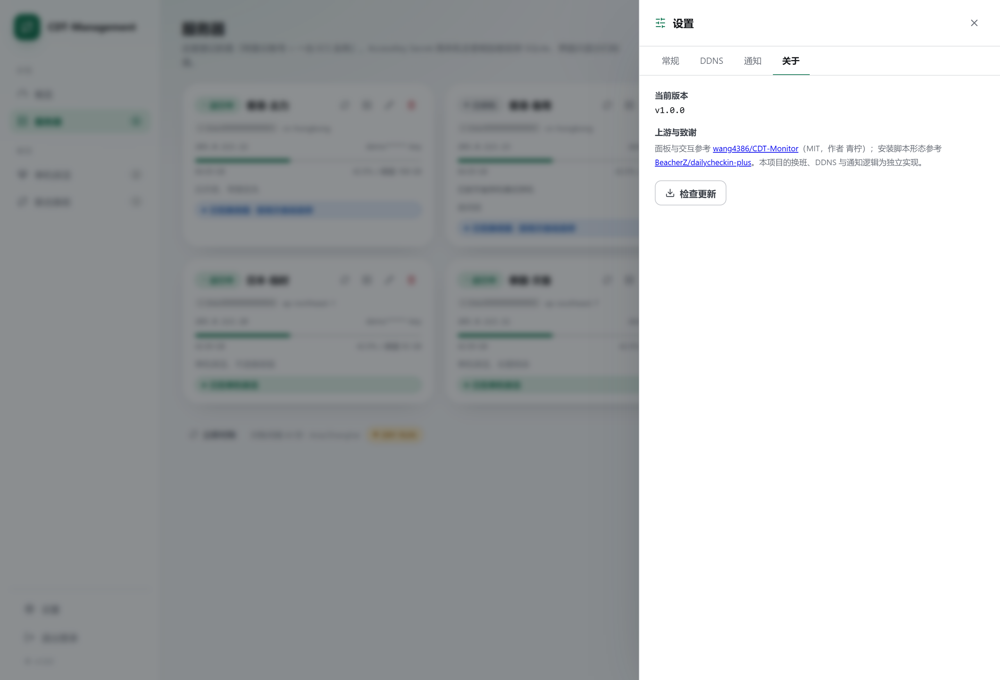

# CDT-Management

跑在 Docker 里的一体化面板：**阿里云 CDT 抢占式实例的单机保活 + 多机联合换班 + DDNS + 通知**，全部在浏览器里配完。

两条独立流程，互不干扰：

| 模块 | 干什么 |
| --- | --- |
| **单机保活** | 实例掉线（含抢占被回收）就自动拉起来，不换班、不停机 |
| **联合换班** | 多台服务器编成一组，各自运行指定小时数，轮流当班，同一时刻只留一台在线 |

当班实例的公网 IP 会同步到 Cloudflare 的 A 记录，换班、故障转移、熔断、抢占恢复都会推一条结构化通知。

[](LICENSE)


> 界面与交互参考 [wang4386/CDT-Monitor](https://github.com/wang4386/CDT-Monitor)（MIT，作者 **青柠**）；安装脚本形态参考 [BeacherZ/dailycheckin-plus](https://github.com/BeacherZ/dailycheckin-plus)。换班、DDNS、通知逻辑为本项目独立实现。详见 [NOTICE.md](NOTICE.md)。

## 快速开始

三种装法任选一种。默认数据目录 `/opt/docker/cdt-management`，宿主机端口 `8282`，容器端口 `8080`。

装好后浏览器打开 `http://你的地址:8282`，首次会引导设置管理员账号。

### 方式一：一键脚本（最省事）

```bash
curl -fsSL https://raw.githubusercontent.com/BeacherZ/cdt-management/main/install.sh | bash
```

内部走【方式三】的 `docker run`；没装 Docker 会自动装。

换端口或换目录自行加参数：

```bash
curl -fsSL https://raw.githubusercontent.com/BeacherZ/cdt-management/main/install.sh | PORT=18282 DIR=/srv/cdt bash
```

**升级**：重跑同一条命令，会先比对版本，已是最新就不动容器；有新版本才删容器重建，数据不动。

### 方式二：docker compose

```yaml
services:
  cdt-management:
    image: ghcr.io/beacherz/cdt-management:latest
    container_name: cdt-management
    restart: unless-stopped
    init: true
    ports:
      - "8282:8080"
    environment:
      TZ: Asia/Shanghai
      CDT_DATA_DIR: /data
    volumes:
      - /opt/docker/cdt-management:/data
```

```bash
mkdir -p /opt/docker/cdt-management
sudo chown -R 10001:10001 /opt/docker/cdt-management   # 容器内 uid 10001，必须可写
docker compose up -d
docker compose logs -f cdt-management
```

**升级**（两行一起粘，任意目录都能跑）：

```bash
D=$(docker inspect -f '{{index .Config.Labels "com.docker.compose.project.working_dir"}}' cdt-management)
cd "$D" && docker compose pull && docker compose up -d
```

### 方式三：docker run

```bash
mkdir -p /opt/docker/cdt-management
# 容器内以 uid 10001 运行，先把数据目录交给它，否则写不了数据库
sudo chown -R 10001:10001 /opt/docker/cdt-management

docker run -d --name cdt-management --restart unless-stopped --init \
  -p 8282:8080 \
  -e TZ=Asia/Shanghai \
  -e CDT_DATA_DIR=/data \
  -v /opt/docker/cdt-management:/data \
  ghcr.io/beacherz/cdt-management:latest
```

**升级**：

```bash
docker pull ghcr.io/beacherz/cdt-management:latest
docker rm -f cdt-management
# 再把上面那条 docker run 原样粘一次，挂载目录不动，数据不会丢
```

Windows 挂载路径写成 `-v D:/docker/cdt-management:/data`。

### 卸载

```bash
# 只删本项目（容器、镜像和数据目录一起删）
curl -fsSL https://raw.githubusercontent.com/BeacherZ/cdt-management/main/install.sh | UNINSTALL=1 bash

# 连 Docker 一起卸（本机所有容器和镜像都会没）
curl -fsSL https://raw.githubusercontent.com/BeacherZ/cdt-management/main/install.sh | UNINSTALL=docker bash
```

两条都会问一次 `yes`，输对了才动手。

## 界面

登录后左侧分成两组：**总览**（概览、服务器）和 **保活**（单机保活、联合换班）。


**联合换班**：按顺序一台一台当班，时间轴按各自时长按比例画出来，谁在线上、下次几点换、待机几台，一屏看完。



**单机保活**：只做一件事——实例掉线就拉起来，不参与换班。



**换班组成员编辑**：顺序上下移、每台运行几小时、本组 DDNS 域名，都在这一屏改完；改完自动按新排班重新计时。



**服务器**：一台实例一张卡，AccessKey Secret 只回显打码值；已编进换班组的机器不再提供"加入单机保活"入口，避免两套流程互相拉扯。



设置抽屉分四页：常规 / DDNS / 通知 / 关于。

| DDNS | 通知 |
| --- | --- |
|  |  |

窄屏也能用，导航收成两行：



登录页与"关于"页（保留上游署名）：

 

## 数据放在哪

| 路径 | 内容 |
| --- | --- |
| `cdt-management.db` | SQLite（WAL）：服务器、换班组、轮次状态、事件、流量采样 |
| `master.key` | 加密主密钥，**必须与 db 一起备份**，丢了 AccessKey Secret 无法解密 |
| `logs/` | 预留日志目录 |

备份就把整个目录拷走；换机器时两个文件一起搬。

## 配一遍的流程

1. **服务器** → 添加服务器：填别名、Region、AccessKey ID/Secret、实例 ID、配额与限流阈值
2. 二选一（或都要，但**同一台不要同时挂两边**）：
   - **单机保活** → 添加保活，勾上这台
   - **联合换班** → 新建换班组，按顺序添加成员并填各自运行几小时（例如两台各 12 小时）
3. **设置 → DDNS**：填 Cloudflare Token（或 Global API Key）、记录名，开启
4. **设置 → 通知**：填 Telegram Bot Token + Chat ID，点「发送测试」确认能收到
5. 回总览点「立即对账」，看第一轮结果

## 功能细节

### 联合换班

轮换是**队列式**的：按成员顺序，每人跑自己设定的时长，跑完切下一台，循环。

- 一个周期 = 所有启用成员时长之和；比如 `A 12h → B 12h` 就是 24 小时一循环，`A 8h → B 8h → C 8h` 也行
- 当班那台必须是 `Running`，其余全部 `Stopped (StopCharging)` 节省停机
- 换班判定要同时满足：当班已 `Running`、其余都已节省停机、当班有公网 IP（DDNS 开启时）
- 满足后**先同步 DDNS，再发通知**，保证通知里的解析状态是真的
- 中途改成员或改时长，会以「现在」为新的轮换起点重算，避免时序错乱
- 手动「立即换班」= 把轮换起点平移到当前班的结束时刻，直接跳下一台

### 流量保护

每台服务器单独配「限流阈值（GB）」。每轮对账：

```
当班流量 ≥ 阈值
  ├─ 有成员没超  → 故障转移：切到用量最低的那台，原当班停机
  ├─ 全部超了     → 全局熔断：全部节省停机
  └─ 别人查不到   → 保守处理：维持当班，不做切换
```

关掉「允许流量故障转移」后，当班超限就直接走「超限停机」。

一处细节：**故障转移在一个班次内只发生一次**。切到替补后，本班次剩下的时间都固定在替补上，
不会每分钟重新判一次、也不会重复记事件或重复推送。

### DDNS

- 只支持 Cloudflare A 记录，Token 与 Global API Key 两种认证
- Zone ID 可以留空，按记录名自动反查根域
- IP 没变就跳过 API 调用；多组用不同域名时缓存按记录名分开
- 组级别的「本组 DDNS 记录」留空则用全局设置

### 通知类型

| 事件 | 触发时机 |
| --- | --- |
| ✅ 换班完成 | 到点换班，且新当班 Running + 旧的全部节省停机 + DDNS 已同步 |
| ⚠️ 临时换班 | 非换班时点因流量超限触发故障转移，新旧状态都就绪后 |
| 🚨 全局熔断 | 全部成员流量达标，确认都已节省停机后，附真实状态参数 |
| 🔴 超限停机 | 当班达标但换不了班，强制节省停机生效后 |
| 🟢 抢占恢复 | 结算过的班次里当班被回收，自动拉起成功并同步解析后 |
| ⚠️ 换班异常 | 班次开始 10 分钟仍未达到预期状态 |
| 🟢 单机保活 | 单机保活的实例被拉起成功 |
| 📊 每日汇总 | 到设定时间（默认 23:58）推全部服务器的流量与额度 |

Telegram 走 HTML 富文本，邮件走 HTML，Webhook 支持 `{title}` `{text}` `{kind}` 占位符。三类渠道可同时开。

## 环境变量

| 变量 | 默认 | 说明 |
| --- | --- | --- |
| `TZ` | `Asia/Shanghai` | 容器时区，影响班次计算 |
| `CDT_DATA_DIR` | `/data` | 数据目录 |
| `CDT_LISTEN_PORT` | `8080` | 容器内监听端口，改这个要同步改 `-p` |
| `CDT_ADMIN_USERNAME` / `CDT_ADMIN_PASSWORD` | 空 | 跳过初始化向导；密码至少 10 位，只在未初始化时生效 |
| `CDT_BRAND` | `CDT-Management` | 顶栏与标签页品牌名 |
| `CDT_REPO` | `BeacherZ/cdt-management` | 「关于」里检查更新的比对对象 |
| `CDT_RECONCILE_INTERVAL` | `60` | 对账间隔秒数（下限 30） |
| `CDT_SHIFT_TIMEOUT_MINUTES` | `10` | 换班超时判定分钟数 |
| `CDT_EVENT_RETAIN_DAYS` | `14` | 事件保留天数 |
| `CDT_HTTP_TIMEOUT` | `12` | 单次 HTTP / 阿里云调用超时 |
| `CDT_DRY_RUN` | `0` | `1` 时不调真实阿里云接口，用于本地 UI 调试 |

## 安全

- AccessKey Secret、CDT/Cloudflare Token、SMTP 密码、Telegram Token、Webhook headers **全部 AES-GCM 加密**后入库，密钥是 `master.key`（容器内 600 权限）
- 面板密码 PBKDF2-SHA256 加盐存储；会话是 HMAC 签名票据，重启不掉线
- 登录失败按 IP 限速（5 分钟 8 次）
- 所有写操作校验 CSRF 双提交 Cookie
- RAM 子账号只给 `AliyunECSFullAccess`（或等价启停策略）+ `AliyunCDTReadOnlyAccess`
- 挂公网务必套 HTTPS 反向代理

## 常见问题

**为什么不用 Go？** 这台机器上没有 Go 工具链，Python 能本地跑通端到端逻辑再交付。运行时是单进程 uvicorn + SQLite，不依赖外部数据库。

**换班了但没收到通知？** 先看「设置 → 通知」里的渠道是否启用、点测试能不能发出去；再看总览的「最近事件」是否有对应记录。通知失败只记事件，不会阻塞换班。

**DDNS 显示「IP 无效跳过」？** 实例还没拿到公网 IP，或者不是公网 IPv4。等下一轮对账，或手动刷新那台服务器。

**所有成员都超限了怎么办？** 会全局熔断，全部节省停机，等下个月流量重置后手动开机，或调整阈值。

**能不能不下线，只保活？** 用「单机保活」模块，不要放进换班组。

**忘了面板密码？** 删掉数据目录里的 `cdt-management.db` 会重置所有配置（`master.key` 留着无影响）。

## 本地开发

```bash
python -m venv .venv && ./.venv/bin/pip install -r requirements.txt
./.venv/bin/python -m app.main              # 后端 :8080
cd web && npm install && npm run dev        # 前端 :5273，已配 /api 代理
npm run build                               # 产物输出到 app/static
CDT_DRY_RUN=1 ./venv/bin/python -m app.main # 不调真实阿里云
```

`CDT_DRY_RUN=1` 时阿里云调用走内存桩：实例状态会在 Stopped → Running 之间流转、流量给固定假值，整条换班链路都能在本地跑通，不会碰真实账号。

配套两个脚本（都只对本地 dry-run 实例、只用假数据）：

```bash
python scripts/smoke_test.py http://127.0.0.1:8099   # 12 组端到端断言
python scripts/seed_demo.py  http://127.0.0.1:8099   # 灌 5 台假服务器 + 换班组
node   scripts/screenshot.cjs http://127.0.0.1:8099  # 重新生成 docs/screenshots
```

截图脚本直接走 CDP 驱动本机 Chrome / Edge，不需要额外装 Playwright。

## 致谢与许可

- 面板的信息架构、视觉语言、交互细节参考 [**wang4386/CDT-Monitor**](https://github.com/wang4386/CDT-Monitor)，作者 **青柠**，MIT 协议。感谢他把 CDT 监控面板做成这么干净的样子。
- 一键安装脚本的形态（版本比对、交互升级、分级卸载）参考 [**BeacherZ/dailycheckin-plus**](https://github.com/BeacherZ/dailycheckin-plus)。
- 阿里云 API 调用走官方 SDK（`aliyun-python-sdk-core` / `aliyun-python-sdk-ecs`），CDT 流量查询用 `ListCdtInternetTraffic`。

本项目以 MIT 协议发布，`LICENSE` 里同时保留了上游版权声明。
