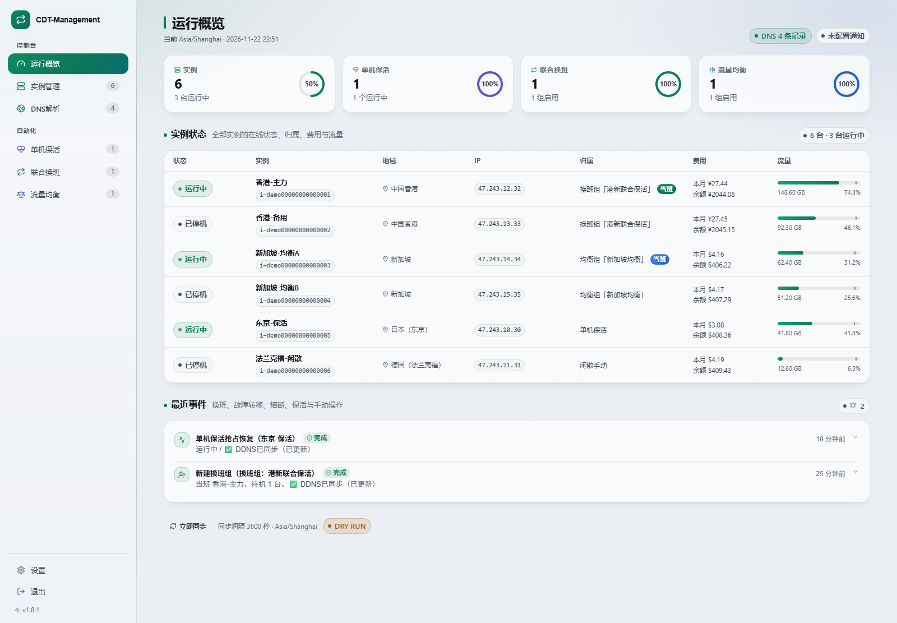
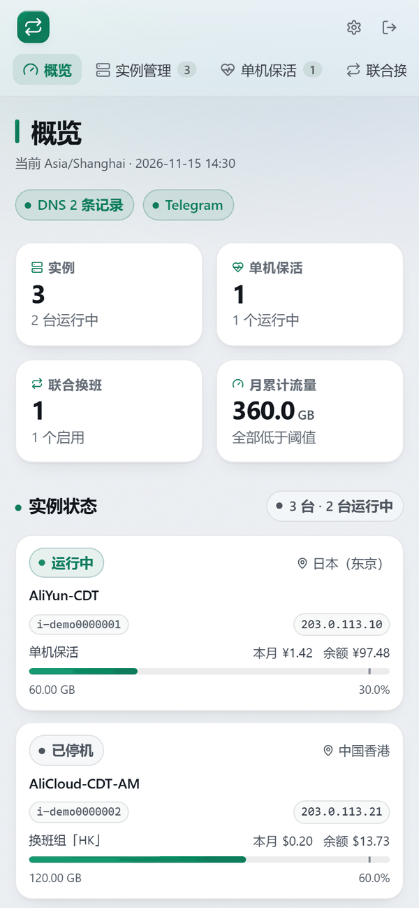
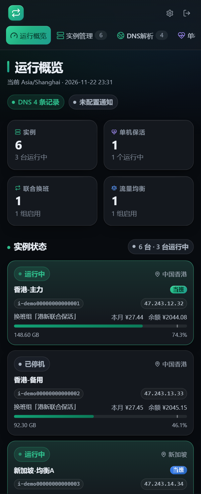

# CDT-Management

**Docker 搭建的网页管理面板：阿里云 CDT 实例的单机保活 + 多机联合换班 + 多机流量均衡 + DDNS + 通知。**

四个模块各管一段，互不干扰：

| 模块 | 作用 |
| --- | --- |
| **单机保活** | 一台实例单独托管，掉线就自动拉起，可自由限定运行时段 |
| **联合换班** | 多台编成一组，按工时或天数轮流当班，同一时刻只留一台 |
| **流量均衡** | 多台共用一套服务，域名指向累计用量最少的那台，周期轮换 |
| **DNS** | 一条记录绑定实例、换班组或均衡组，IP 变化时自动同步 |

这几套流程之上还有一层优先级最高的**流量保护**：每台单独设阈值，超限就停。

除换班组成员和单机保活托管中的实例外，**闲散实例**和均衡组的**非当班实例**都可手动开关机。

**实例不限抢占式**：流量保护和流量均衡只看用量、不看计费方式，按量付费与包年包月同样适用。

[](LICENSE)


## 🖥️界面

浅色 / 深色（`设置 → 常规设置 → 外观`，点击查看大图）

<p align="center">
  <a href="docs/screenshots/02-dashboard.png"></a>
  <a href="docs/screenshots/03-dashboard-dark.png"></a>
</p>

手机端（自适应布局，点击查看大图）

<p align="center">
  <a href="docs/screenshots/04-mobile-dashboard.png"></a>
  <a href="docs/screenshots/05-mobile-dashboard-dark.png"></a>
  <a href="docs/screenshots/06-mobile-instances.png"></a>
  <a href="docs/screenshots/07-mobile-instances-dark.png"></a>
</p>

## ✨主要功能

### 流量保护

**说明**：每台单独配阈值，超限自动停机；换班组和均衡组都先试故障转移，全组超限才熔断。

<details>
<summary>详细说明</summary>

> 超限停机后不再拉起。
>
> 流量回落到阈值以下（月初流量包重置或调高阈值）会清掉标记，自动恢复开机并保活。
>
> **换班组故障转移两种**：当班流量到阈值；当班被抢占后连续 3 次拉起失败。
>
> **均衡组故障转移两种**：当班流量到阈值，交给用量最少的成员；接替的成员 3 次拉不起来，换下一个。
>
> **统计口径**：流量取自 `cdt:ListCdtInternetTraffic`，按流量包合计。免费额度按账号分两个池——中国内地 20 GB/月、非中国内地（含中国香港）200 GB/月，同账号同池的实例共用这一份额度，读到的也是同一个数字（跨地域同样合并计算）。

</details>

**目的**：不让任何一台实例烧穿流量包。

### 单机保活

**说明**：一台实例单独托管，掉线就拉起，不换班、不涉及其他实例。

<details>
<summary>详细说明</summary>

> 每轮巡检（默认 60 秒，间隔与起始秒可自定义）发现停机就下发开机，直到拉起；启动中不重复下发。
>
> **运行窗口（可选）**：只让实例在指定时段或日期在线，比如每天 08:00–20:00，或本月 1–16 号；两项都填按交集算。
>
> - 结束早于开始视为跨天（如 `20:00–06:00`）；结束填 `00:00` 表示到 24:00；起止相同即全天
> - 窗口外自动停机，窗口内自动保活，两端都**不推通知**

</details>

**目的**：掉线第一时间拉起，保住在线率；运行窗口让它只在用得上的时间在线，省费用。

### 联合换班

**说明**：多台实例编成一组，轮流当班，同一时刻只留一台在线。排班周期二选一：

<details>
<summary>详细说明</summary>

> **一天一轮**：填每台的工时，或直接排 0–24 点的固定时刻表，24 小时内换完。
>
> **一月一轮**：填每台上几天，1 号 0 点从第 1 位开始，最后一位承接当月剩下的天数。
>
> **交接顺序**：上班准时——到点先把当班实例开机；下班不抢跑——等下一台确认运行中，上一台才停机。

</details>

**目的**：多台不必同时在线，降低成本，并把 CDT 免费流量包都用上。

### 流量均衡

**说明**：组内几台实例跑同一套服务，域名同一时刻只指向其中一台。每到一个整点比对组内累计用量，当班比最少的那台多出差值阈值，就把域名切过去。

<details>
<summary>详细说明</summary>

> **成员前提**：每台都部署同一套服务、同一份配置，域名指过去就能直接接客，不用改客户端。
>
> **评估周期**：1 / 3 / 6 / 12 / 24 小时，只在整点评估（3 小时即 00/03/06…，24 小时是每天 0 点）。
>
> **差值阈值**：当班比最少的那台多出这么多 GB 才值得切；设太小，域名会每个周期抖一次。可选 1 / 5 / 10 / 30 / 50 GB（默认 10 GB），国内包只有 20 GB，建议选 1 GB 或 5 GB。
>
> **切换顺序**：先把接替的那台拉起并确认在运行 → 再改 DNS → 最后才处理其余成员。
>
> **其余成员只停不拉**：组员可能三台以上，一次切换只「拉」接替的那台，其余成员一律不下发开机；被换下来的当班和其他待机成员，设了「下班后停机」的按实例设置的停机模式停掉，设了保持运行的不去动它。
>
> **状态到位才出报告**：下发停/开机只是指令，事件会等每台真实到位（读到 Stopped / Running 与真实停机模式）才收尾并推送报告，最长等 10 分钟。
>
> **评估点只比差值**：每轮只读全组用量、比差值，期间不对任何成员做开关机纠正，开关机只发生在换人这一刻（见上两行）。待机成员流量到阈值照样会被停，这是流量保护。
>
> **与换班的区别**：换班看时钟、到点交接停机；均衡看累计流量、不排班，两者不能挂同一台机器。
>
> **统计延迟**：API 获取的流量使用有延迟；对实时性有要求的 CDT 深度用户，建议自行跑达量关机 vnstat 脚本。

</details>

**目的**：不想按时间排班时，让流量包额度都用上：谁用得少，域名就指向谁。

### DNS

**说明**：一条记录绑一台实例、一个换班组或一个均衡组；目标在运行且公网 IP 变了（开机换 IP、换弹性 IP），下一轮巡检自动指过去。

<details>
<summary>详细说明</summary>

> 每轮巡检只拿 API 返回的 IP 比对本地记录，不查 Cloudflare。
>
> 手动开机、保活拉起、换班结算这三个时点会强制查一次真实解析值；一致就不动记录，页面的「上次同步」也不跳。

</details>

**目的**：换了弹性 IP 不用手改 DNS；换班组和均衡组绑定的域名始终指向当班那台，成员部署同样的服务即可无感切换。

### 通知

**说明**：支持 Telegram、邮件、Webhook 三类渠道，可同时开启。

<details>
<summary>通知示例（点击查看大图）</summary>

<p align="center">
  <a href="docs/screenshots/25-notify-overview.png"></a>
</p>

</details>

**目的**：换班、故障转移、熔断、超限停机、均衡切换、抢占恢复、异常与每日报告都会推送，不用盯面板。

## 🚀快速开始

三种装法任选。默认数据目录 `/opt/docker/cdt-management`，宿主机 `8282` 映射容器 `8080`。

装好后访问 `http://你的地址:8282`，首次会引导创建管理员。

### 方式一：一键脚本（最省事）

```bash
curl -fsSL https://raw.githubusercontent.com/BeacherZ/cdt-management/main/install.sh | bash
```

内部走方式三的 `docker run`；没装 Docker 会自动装。换端口或目录加环境变量：

```bash
curl -fsSL https://raw.githubusercontent.com/BeacherZ/cdt-management/main/install.sh | PORT=18282 DIR=/srv/cdt bash
```

**升级**：重跑同一条命令。已是最新就不动容器，有新版本才重建，数据不动。

### 方式二：docker compose

```yaml
services:
  cdt-management:
    image: ghcr.io/beacherz/cdt-management:latest
    container_name: cdt-management
    restart: unless-stopped
    init: true
    ports:
      - "8282:8080"
    environment:
      TZ: Asia/Shanghai
      CDT_DATA_DIR: /data
    volumes:
      - /opt/docker/cdt-management:/data
```

```bash
mkdir -p /opt/docker/cdt-management
docker compose up -d
docker compose logs -f cdt-management
```

**升级**（两行一起粘，任意目录可跑）：

```bash
D=$(docker inspect -f '{{index .Config.Labels "com.docker.compose.project.working_dir"}}' cdt-management)
cd "$D" && docker compose pull && docker compose up -d
```

### 方式三：docker run

```bash
mkdir -p /opt/docker/cdt-management

docker run -d --name cdt-management --restart unless-stopped --init \
  -p 8282:8080 \
  -e TZ=Asia/Shanghai \
  -e CDT_DATA_DIR=/data \
  -v /opt/docker/cdt-management:/data \
  ghcr.io/beacherz/cdt-management:latest
```

**升级**：

```bash
docker pull ghcr.io/beacherz/cdt-management:latest
docker rm -f cdt-management
# 再把上面那条 docker run 原样粘一次，挂载目录不动，数据不会丢
```

Windows 挂载路径写成 `-v D:/docker/cdt-management:/data`。

### 卸载

```bash
# 只删本项目（容器、镜像和数据目录一起删）
curl -fsSL https://raw.githubusercontent.com/BeacherZ/cdt-management/main/install.sh | UNINSTALL=1 bash

# 连 Docker 一起卸（本机所有容器和镜像都会没）
curl -fsSL https://raw.githubusercontent.com/BeacherZ/cdt-management/main/install.sh | UNINSTALL=docker bash
```

两条都会再确认一次 `yes`。

## 🔑阿里云 RAM 权限

完整使用需给当前用户添加以下三种 RAM 权限（RAM 访问控制 → 身份管理 → 用户 → 权限管理）：

| RAM 权限 | 用在哪 |
| --- | --- |
| `AliyunECSFullAccess` | 查实例、开机、停机（含节省停机） |
| `AliyunCDTReadOnlyAccess` | 读当月 CDT 公网流量 |
| `AliyunBSSReadOnlyAccess` | 账户余额、实例账单 |

- 少了 CDT 这组，整轮对账都会失败（不是流量显示为空），必须给
- 少了 BSS 这组，只是费用和余额看不到，启停不受影响
- 国内站和国际站的 AK 不通用，一台实例一套凭据
- RAM 控制台：[国内站](https://ram.console.aliyun.com/users) · [国际站](https://ram.console.alibabacloud.com/users)

## 🧭配置流程

1. **实例管理** → 添加实例：填别名、Region、AccessKey ID/Secret、实例 ID、配额与超限阈值，按需选停机模式（默认节省停机）
2. 四选一（不同的机器可以各走各的，但**同一台只能进一种流程**）：
   - **单机保活** → 添加保活，勾上这台；要限定运行时段/日期就在同一个设置页里填
   - **联合换班** → 新建换班组，选排班周期（一天一轮按工时，一月一轮按天数），按顺序添加成员
   - **流量均衡** → 新建均衡组，选评估周期与差值阈值，按顺序加成员（每台的「下班后」动作单独设）
   - **闲散手动** → 什么都不加，留在实例列表里手动开关机；包年包月不进均衡组、抢占式只在测试时开机，都走这条
3. **设置 → DDNS**：填 Cloudflare Token（或 Global API Key）、TTL，开启
4. **DNS**：加域名记录，再把它绑到某台实例、某个换班组或某个均衡组（不绑就不会被同步）
5. **设置 → 通知**：填 Telegram Bot Token + Chat ID，点「发送测试」确认能收到
6. 回「运行概览」点「立即同步」，看第一轮结果

## 💾数据放在哪

| 路径 | 内容 |
| --- | --- |
| `cdt-management.db` | SQLite：实例、保活、换班组、均衡组、换班进度、事件、流量采样 |
| `master.key` | 加密主密钥，**必须与 db 一起备份**，丢了 AccessKey Secret 无法解密 |

备份直接拷整个目录；换机器时两个文件一起搬。

## 🔒公网部署与安全

直接暴露到公网并不安全，**建议前面套一层 HTTPS 反向代理**，只对外开放 443。

## ❓常见问题

**单机保活**

手动关了又被拉起？保活就是「停了就拉」，不想被拉就加运行窗口或移出保活。

窗口两端怎么收不到通知？进出运行窗口只按设置开关机，属预期动作，只落事件不推送。

**联合换班**

到点了没换？要等下一台确认 Running 才停上一台，慢一两分钟正常。

提示只能归一个流程管？换班组、均衡组、单机保活三选一，先移出再加。

**流量均衡**

建组时开关机了？只在建组那次按成员设置摆正一遍，之后只比流量。

切换后待机没被拉起？只拉接替的那台，其余只停不拉。

**DNS 与 DDNS**

「IP 无效跳过」？实例还没拿到公网 IPv4。

记录一直不动？没绑定的记录不会被同步。

**通知**

Bot Token 填了没反应？整串原样粘贴（如 `123456789:AAH…`），冒号前那串数字不能少、前后不要有空格。

群组收不到或一直超时？chat_id 整串原样粘贴，别手改、别带空格；境内服务器填代理。

**数据**

换机器？必须带上 `master.key`，否则 AccessKey Secret 解不开。

时间偏 8 小时？时区按「设置 → 常规设置 → 时区」算，跟浏览器无关；时钟跟宿主机走，宿主机没对时就一起偏。

---

## ⭐ Show your support

如果这个项目对你有帮助，请给它一个 ⭐️！
