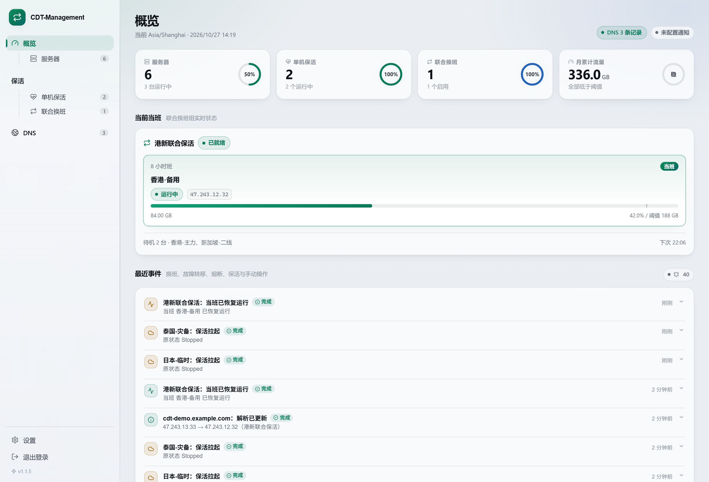
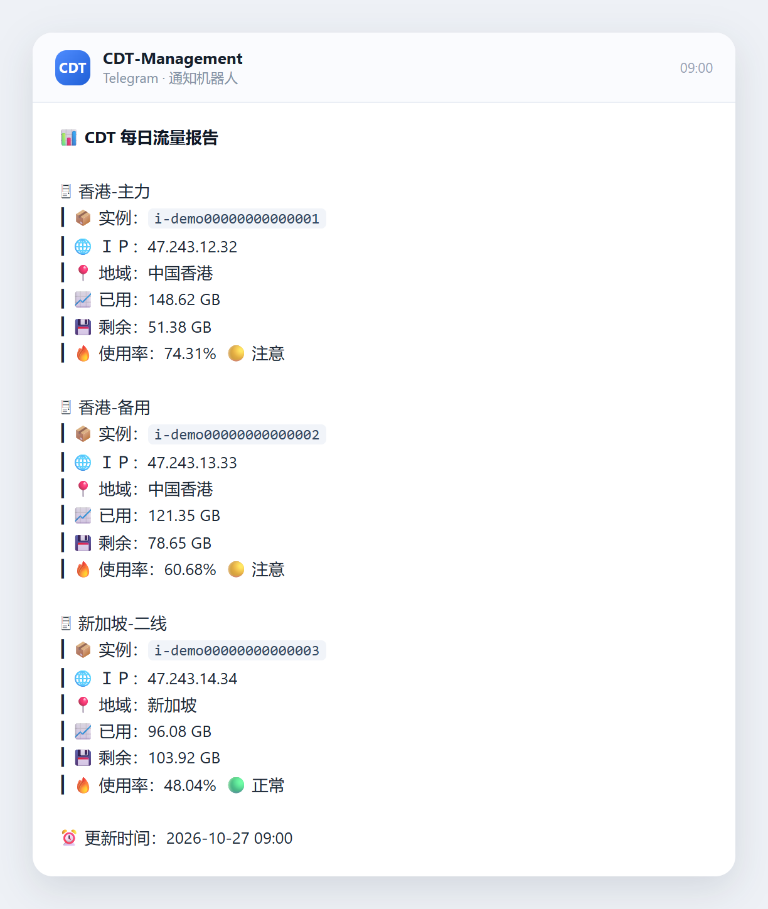
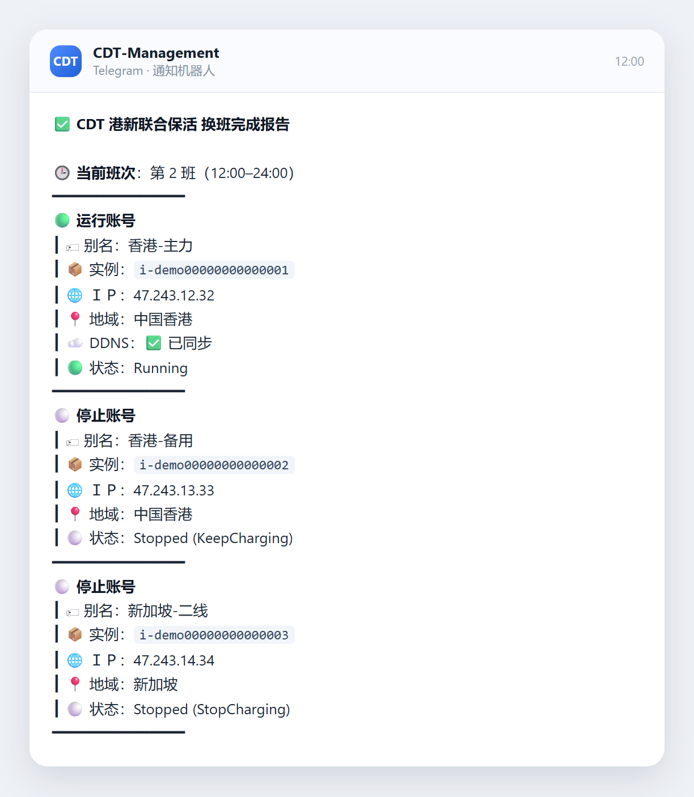
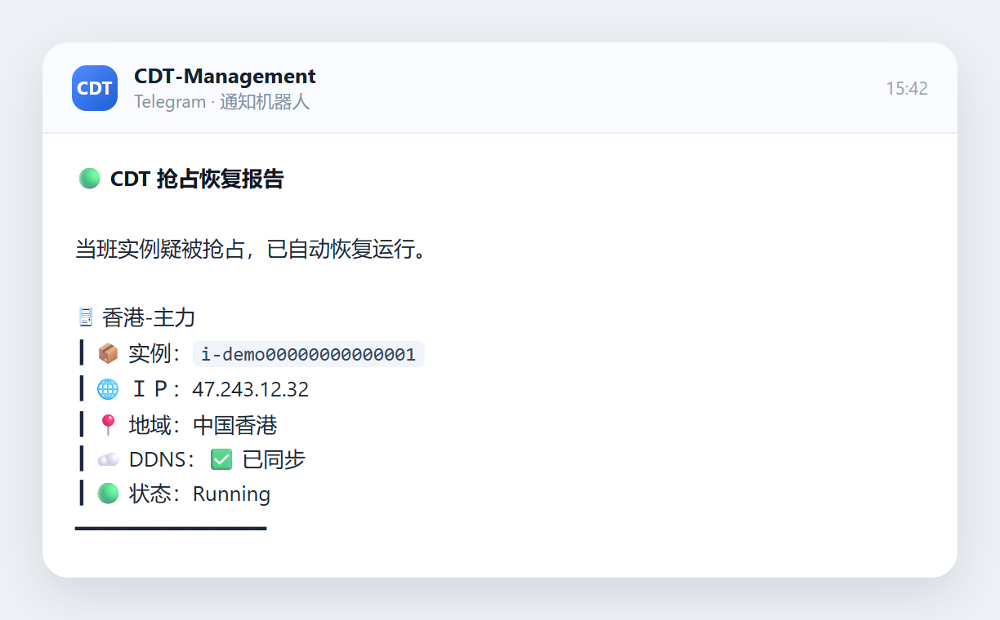

# CDT-Management

**Docker 搭建的网页管理面板：阿里云 CDT 抢占式实例的单机保活 + 多机联合换班 + DDNS + 通知。**

三个模块各管一段，互不干扰：

| 模块 | 干什么 |
| --- | --- |
| **单机保活** | 实例掉线（含抢占被回收）就自动拉起来，不换班、不停机 |
| **联合换班** | 多台服务器编成一组，各自运行指定时长，轮流当班，同一时刻只留一台在线 |
| **DNS** | 域名记录集中管理，一条记录显式绑一台机器或一个换班组，没绑的谁也不会动 |

当班实例的公网 IP 会同步到它绑定的 Cloudflare A 记录 —— 一台机器可以同时挂多条域名，开机时一起更新。
换班、故障转移、熔断、抢占恢复都会推一条通知。没编进任何流程的**闲散服务器**照旧可以手动开关机。

[](LICENSE)


## 界面

最上面四张卡：**服务器 / 单机保活 / 联合换班 / 月累计流量**，前三张点一下就进去。



## 快速开始

三种装法任选一种。默认数据目录 `/opt/docker/cdt-management`，宿主机端口 `8282`，容器端口 `8080`。

装好后浏览器打开 `http://你的地址:8282`，首次会引导设置管理员账号。

### 方式一：一键脚本（最省事）

```bash
curl -fsSL https://raw.githubusercontent.com/BeacherZ/cdt-management/main/install.sh | bash
```

内部走【方式三】的 `docker run`；没装 Docker 会自动装。换端口或换目录自行加参数：

```bash
curl -fsSL https://raw.githubusercontent.com/BeacherZ/cdt-management/main/install.sh | PORT=18282 DIR=/srv/cdt bash
```

**升级**：重跑同一条命令，会先比对版本，已是最新就不动容器；有新版本才删容器重建，数据不动。

### 方式二：docker compose

```yaml
services:
  cdt-management:
    image: ghcr.io/beacherz/cdt-management:latest
    container_name: cdt-management
    restart: unless-stopped
    init: true
    ports:
      - "8282:8080"
    environment:
      TZ: Asia/Shanghai
      CDT_DATA_DIR: /data
    volumes:
      - /opt/docker/cdt-management:/data
```

```bash
mkdir -p /opt/docker/cdt-management
docker compose up -d
docker compose logs -f cdt-management
```

**升级**（两行一起粘，任意目录都能跑）：

```bash
D=$(docker inspect -f '{{index .Config.Labels "com.docker.compose.project.working_dir"}}' cdt-management)
cd "$D" && docker compose pull && docker compose up -d
```

### 方式三：docker run

```bash
mkdir -p /opt/docker/cdt-management

docker run -d --name cdt-management --restart unless-stopped --init \
  -p 8282:8080 \
  -e TZ=Asia/Shanghai \
  -e CDT_DATA_DIR=/data \
  -v /opt/docker/cdt-management:/data \
  ghcr.io/beacherz/cdt-management:latest
```

**升级**：

```bash
docker pull ghcr.io/beacherz/cdt-management:latest
docker rm -f cdt-management
# 再把上面那条 docker run 原样粘一次，挂载目录不动，数据不会丢
```

Windows 挂载路径写成 `-v D:/docker/cdt-management:/data`。


### 卸载

```bash
# 只删本项目（容器、镜像和数据目录一起删）
curl -fsSL https://raw.githubusercontent.com/BeacherZ/cdt-management/main/install.sh | UNINSTALL=1 bash

# 连 Docker 一起卸（本机所有容器和镜像都会没）
curl -fsSL https://raw.githubusercontent.com/BeacherZ/cdt-management/main/install.sh | UNINSTALL=docker bash
```

两条都会问一次 `yes`，输对了才动手。

## 阿里云 RAM 权限

完整使用本项目功能需要给当前用户添加以下三种 RAM 权限：  
（RAM 访问控制 - 身份管理 - 用户 - 权限管理）

| RAM 权限 | 用在哪 |
| --- | --- |
| `AliyunECSFullAccess` | 查实例、开机、节省停机 |
| `AliyunCDTReadOnlyAccess` | 读当月 CDT 公网流量 |
| `AliyunBSSReadOnlyAccess` | 账户余额、实例账单 |

- 少了 CDT 这组，整轮对账都会失败，不是流量空着 —— 必须给
- 少了 BSS 这组，费用和余额显示不出来，启停照常
- 国内站和国际站的 AK 不通用，一台服务器一套凭据
- RAM 控制台：[国内站](https://ram.console.aliyun.com/users) · [国际站](https://ram.console.alibabacloud.com/users)

## 配一遍的流程

1. **服务器** → 添加服务器：填别名、Region、AccessKey ID/Secret、实例 ID、配额与限流阈值
2. 二选一（或都要，但**同一台不要同时挂两边**）：
   - **单机保活** → 添加保活，勾上这台
   - **联合换班** → 新建换班组，按顺序添加成员并填各自运行时长
3. **设置 → DDNS**：填 Cloudflare Token（或 Global API Key）、TTL，开启
4. **DNS**：加域名记录，再把它绑到某台机器或某个换班组（不绑就谁也不会去动它）
5. **设置 → 通知**：填 Telegram Bot Token + Chat ID，点「发送测试」确认能收到
6. 回概览点「立即同步」，看第一轮结果

## 主要功能

### 单机保活

一台机器自己管自己：掉了就拉起来，不换班，也不碰别的机器。

- 只认 `Stopped` 一种状态：查到已停机就自动开机；运行中、启动中、重启中一律不插手
- 拉起是异步的：先记一条「保活拉起」，等实例真到 Running 才同步它身上的 DDNS 记录，再补发 🟢 抢占恢复 通知（正文写「实例疑被抢占，已自动恢复运行」）
- 库存不足、AccessKey 失效这类错误，同一台连续失败只记一条，恢复后自动解除，不会每分钟刷一条
- 同一台机器如果也在启用的换班组里，单机保活自动让位给换班组（只留一条提醒），避免两边互相拉扯
- 保活页可以对单台单独暂停：暂停后不再拉它，DNS 绑定照旧保留

### 联合换班

按成员顺序轮流当班，每人跑自己设定的时长，跑完切下一台，循环。

- 当班那台运行、其余全部节省停机，才算这一班换完
- 全部到位后才同步 DDNS、发通知，通知里的状态都是确认过的
- 换班组卡片头部的**立即换班**按钮可以一键切下一台，走完整流程并推一条「换班完成报告(手动换班)」
- 也支持固定时刻表模式：给每个成员填上班时刻，到点自动切换。时刻表要刚好铺满一天，有空档或重叠会直接拒绝保存
- 一台服务器只能编进一个启用的换班组（停用的组可以共用成员），否则两套流程会互相启停
- 新建组保存时会按排班表整队一次；解散组只删配置，组员保持当前状态回到闲散手动

### 流量保护

每台服务器单独配「限流阈值（GB）」。当班流量到阈值时：

- 还有没超的成员 → **故障转移**：切到用量最低的那台，原当班停机
- 全部都超了 / 其他成员状态查不到 → **全局熔断**：全部节省停机（找不到替班就绝不让超限的那台继续跑）

关掉「允许流量故障转移」后，当班超限就直接停机。

### DNS

- 只支持 Cloudflare A 记录，Token 与 Global API Key 两种认证
- 一条记录绑一个目标；反过来一个目标可以挂多条记录，`www` 和 `api` 各绑一条就行
- 它一开机（换班轮到、保活拉起、手动开机），挂着的记录会一起指向新 IP
- 绑在单台实例上的记录还能省一步：阿里云换了弹性 IP，不用去 Cloudflare 手改，下次开机 / 换班自动跟上
- 删服务器、解散换班组会松开落在它身上的记录；把机器移出单机保活**不会**动绑定

### 通知

| 事件 | 触发时机 |
| --- | --- |
| ✅ 换班完成 | 到点换班，新当班运行、其余停机、DDNS 已同步 |
| ⚠️ 故障转移 | 当班流量到阈值，自动切到用量最低的一台 |
| 🚨 全局熔断 | 全部成员都到阈值，全部节省停机 |
| 🟢 抢占恢复 | 当班被回收后自动拉起（单机保活也是这个标题） |
| ⚠️ 换班异常 | 班次开始后迟迟没达到预期状态 |
| 📊 每日汇总 | 到设定时间推全部服务器的流量与额度 |

支持 Telegram、邮件、Webhook 三类渠道同时开启。

实际推出来的样子：

<p align="center">
  
  <br><sub>CDT 每日流量报告</sub>
</p>

<p align="center">
  
  <br><sub>CDT（换班组）换班完成报告</sub>
</p>

<p align="center">
  
  <br><sub>CDT 抢占恢复报告</sub>
</p>

## 数据放在哪

| 路径 | 内容 |
| --- | --- |
| `cdt-management.db` | SQLite：服务器、换班组、换班进度、事件、流量采样 |
| `master.key` | 加密主密钥，**必须与 db 一起备份**，丢了 AccessKey Secret 无法解密 |

备份就把整个目录拷走；换机器时两个文件一起搬。

## 常见问题

**换班了但没收到通知？** 先看「设置 → 通知」里渠道是否启用、点测试能不能发出去；再看概览的「最近事件」有没有对应记录。通知失败只记事件，不会阻塞换班。

**DDNS 显示「IP 无效跳过」？** 实例还没拿到公网 IP，或者不是公网 IPv4。等下一轮同步，或手动刷新那台服务器。

**所有成员都超限了怎么办？** 会全局熔断，全部节省停机，等下个月流量重置后手动开机，或调整阈值。

**忘了面板密码？** 删掉数据目录里的 `cdt-management.db` 会重置所有配置。

## 本地开发

```bash
python -m venv .venv && ./.venv/bin/pip install -r requirements.txt
./.venv/bin/python -m app.main              # 后端 :8080
cd web && npm install && npm run dev        # 前端 :5273，已配 /api 代理
CDT_DRY_RUN=1 ./.venv/bin/python -m app.main # 不调真实阿里云
```

`CDT_DRY_RUN=1` 时阿里云调用走内存桩，整条换班链路能在本地跑通，不会碰真实账号。

## 致谢与许可

- 面板的信息架构、视觉语言、交互细节参考 [**wang4386/CDT-Monitor**](https://github.com/wang4386/CDT-Monitor)，作者 **青柠**，MIT 协议。
- 一键安装脚本的形态参考 [**BeacherZ/dailycheckin-plus**](https://github.com/BeacherZ/dailycheckin-plus)。

本项目以 MIT 协议发布，`LICENSE` 里同时保留了上游版权声明。
