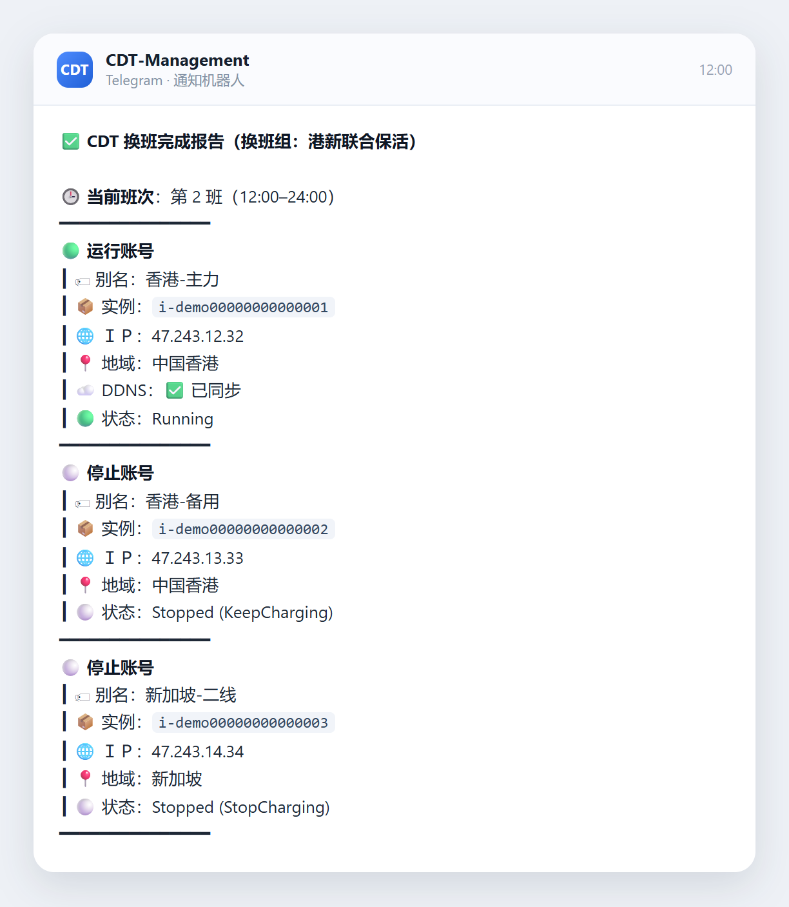
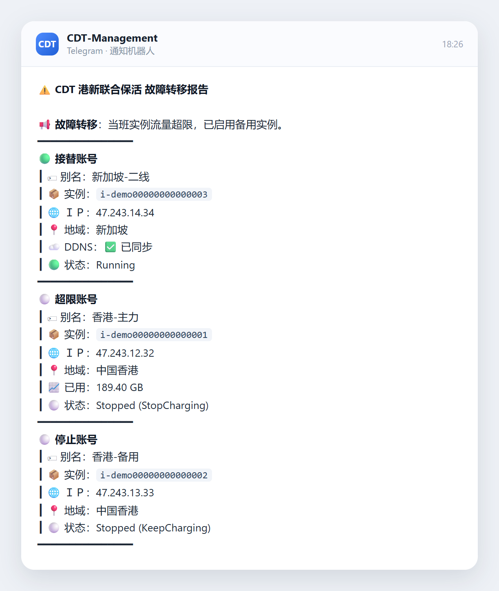
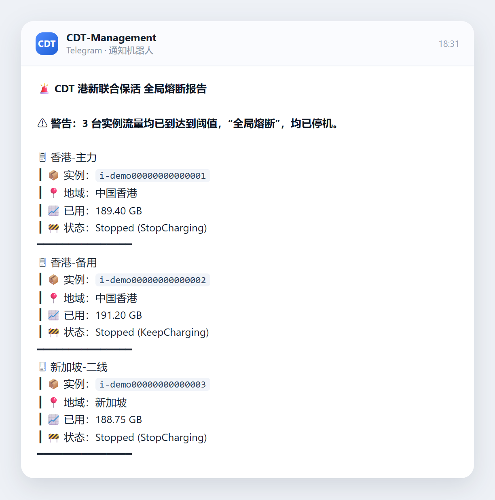
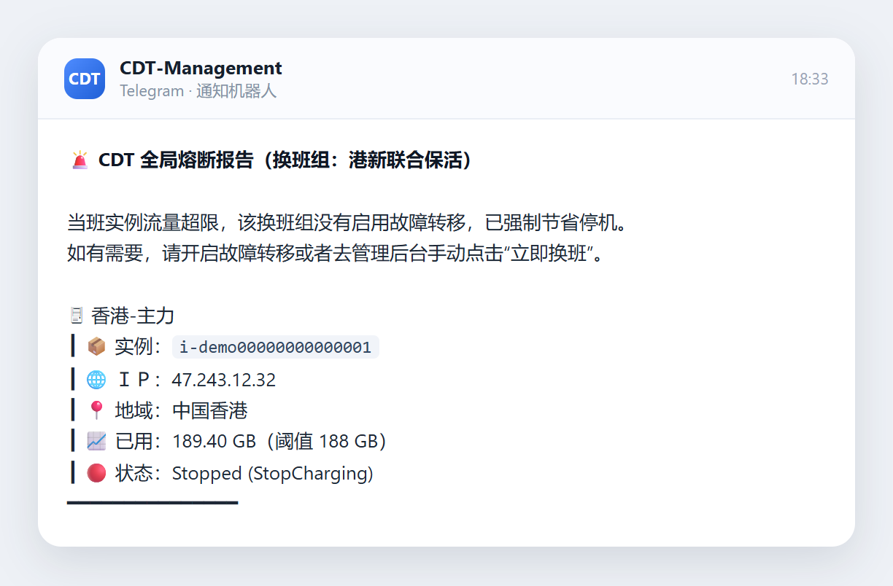
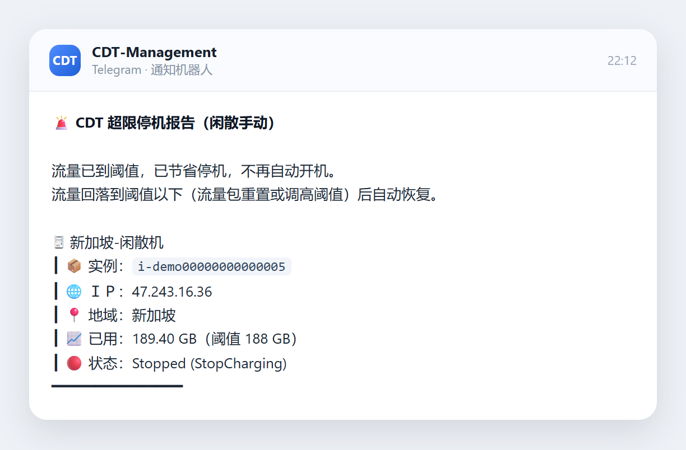
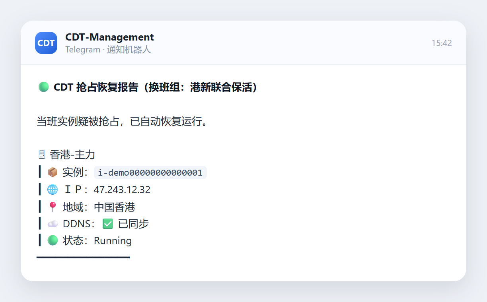
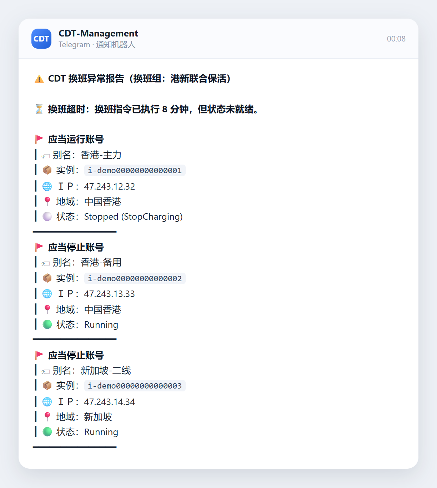
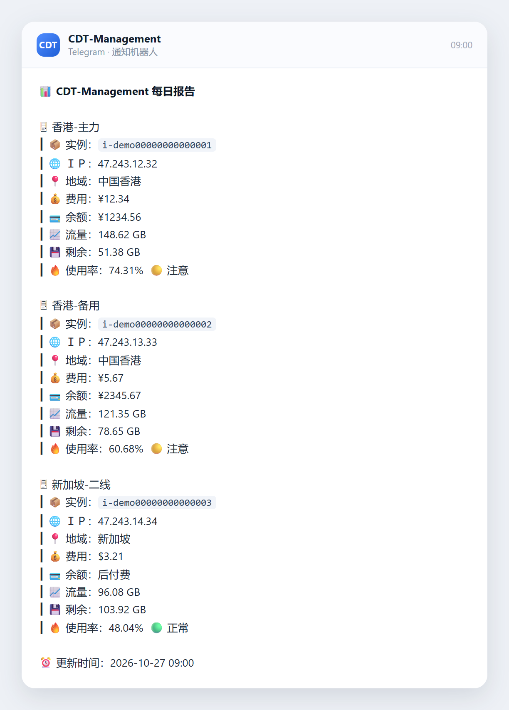

# CDT-Management

**Docker 搭建的网页管理面板：阿里云 CDT 抢占式实例的单机保活 + 多机联合换班 + DDNS + 通知。**

三个模块各管一段，互不干扰：

| 模块 | 作用 |
| --- | --- |
| **单机保活** | 实例掉线（含抢占被回收）就自动拉起来，不换班、不停机 |
| **联合换班** | 多台实例编成一组，按「一天一轮」的工时或「一月一轮」的天数轮流当班 |
| **DNS** | 域名记录集中管理，一条记录显式绑一台实例或一个换班组，没绑的谁也不会动 |

没编进任何流程的**闲散实例**照旧可以手动开关机。

**实例不限抢占式，按量付费 / 包年包月的实例同样适用，只是用不到「抢占恢复」。**

[](LICENSE)


## 界面


## 快速开始

三种装法任选一种。默认数据目录 `/opt/docker/cdt-management`，宿主机端口 `8282`，容器端口 `8080`。

装好后浏览器打开 `http://你的地址:8282`，首次会引导设置管理员账号。

### 方式一：一键脚本（最省事）

```bash
curl -fsSL https://raw.githubusercontent.com/BeacherZ/cdt-management/main/install.sh | bash
```

内部走【方式三】的 `docker run`；没装 Docker 会自动装。换端口或换目录自行加参数：

```bash
curl -fsSL https://raw.githubusercontent.com/BeacherZ/cdt-management/main/install.sh | PORT=18282 DIR=/srv/cdt bash
```

**升级**：重跑同一条命令，会先比对版本，已是最新就不动容器；有新版本才删容器重建，数据不动。

### 方式二：docker compose

```yaml
services:
  cdt-management:
    image: ghcr.io/beacherz/cdt-management:latest
    container_name: cdt-management
    restart: unless-stopped
    init: true
    ports:
      - "8282:8080"
    environment:
      TZ: Asia/Shanghai
      CDT_DATA_DIR: /data
    volumes:
      - /opt/docker/cdt-management:/data
```

```bash
mkdir -p /opt/docker/cdt-management
docker compose up -d
docker compose logs -f cdt-management
```

**升级**（两行一起粘，任意目录都能跑）：

```bash
D=$(docker inspect -f '{{index .Config.Labels "com.docker.compose.project.working_dir"}}' cdt-management)
cd "$D" && docker compose pull && docker compose up -d
```

### 方式三：docker run

```bash
mkdir -p /opt/docker/cdt-management

docker run -d --name cdt-management --restart unless-stopped --init \
  -p 8282:8080 \
  -e TZ=Asia/Shanghai \
  -e CDT_DATA_DIR=/data \
  -v /opt/docker/cdt-management:/data \
  ghcr.io/beacherz/cdt-management:latest
```

**升级**：

```bash
docker pull ghcr.io/beacherz/cdt-management:latest
docker rm -f cdt-management
# 再把上面那条 docker run 原样粘一次，挂载目录不动，数据不会丢
```

Windows 挂载路径写成 `-v D:/docker/cdt-management:/data`。


### 卸载

```bash
# 只删本项目（容器、镜像和数据目录一起删）
curl -fsSL https://raw.githubusercontent.com/BeacherZ/cdt-management/main/install.sh | UNINSTALL=1 bash

# 连 Docker 一起卸（本机所有容器和镜像都会没）
curl -fsSL https://raw.githubusercontent.com/BeacherZ/cdt-management/main/install.sh | UNINSTALL=docker bash
```

两条都会问一次 `yes`，输对了才动手。

## 阿里云 RAM 权限

完整使用本项目功能需要给当前用户添加以下三种 RAM 权限：  
（RAM 访问控制 - 身份管理 - 用户 - 权限管理）

| RAM 权限 | 用在哪 |
| --- | --- |
| `AliyunECSFullAccess` | 查实例、开机、节省停机 |
| `AliyunCDTReadOnlyAccess` | 读当月 CDT 公网流量 |
| `AliyunBSSReadOnlyAccess` | 账户余额、实例账单 |

- 少了 CDT 这组，整轮对账都会失败，不是流量空着 —— 必须给
- 少了 BSS 这组，费用和余额显示不出来，启停照常
- 国内站和国际站的 AK 不通用，一台实例一套凭据
- RAM 控制台：[国内站](https://ram.console.aliyun.com/users) · [国际站](https://ram.console.alibabacloud.com/users)

## 配一遍的流程

1. **服务器** → 添加服务器：填别名、Region、AccessKey ID/Secret、实例 ID、配额与限流阈值
2. 二选一（或都要，但**同一台不要同时挂两边**）：
   - **单机保活** → 添加保活，勾上这台
   - **联合换班** → 新建换班组，选排班周期（一天一轮按工时，一月一轮按天数），按顺序添加成员
3. **设置 → DDNS**：填 Cloudflare Token（或 Global API Key）、TTL，开启
4. **DNS**：加域名记录，再把它绑到某台实例或某个换班组（不绑就谁也不会去动它）
5. **设置 → 通知**：填 Telegram Bot Token + Chat ID，点「发送测试」确认能收到
6. 回概览点「立即同步」，看第一轮结果

## 主要功能

### 单机保活

**说明**：一台实例自己管自己，掉了就拉起来，不换班、不碰别的实例。

> 每分钟巡检，停着就再下发一次开机，直到起来为止；启动中不重复下发。

**目的**：失联第一时间拉起来，保证在线率。

### 联合换班

**说明**：多台实例编成一组，按顺序轮流当班，同一时刻只留一台在线。排班周期两种任选：

>  **一天一轮**：填每台的工时，或直接排 0–24 点的固定时刻表，24 小时内换完；
> 
>  **一月一轮**：填每台上几天，1 号 0 点从第 1 位开始，最后一位承接当月剩下的天数。
> 
>  **交接顺序**：上班准时——到点先把当班实例开机；下班不抢跑——等下一台确认运行中，上一台才停机。

**目的**：通过换班大幅度降低抢占式实例的费用。

### 流量保护

**说明**：每台单独配阈值，超限自动停机；换班组会先尝试故障转移，全超才熔断。

> **故障转移**两种触发：当班流量到阈值，或当班被抢占后每分钟试一次、试满 3 次（约 3 分钟）仍起不来。
> 
>一天一轮只在本班次内换人，下个换班点照常回原排班；一月一轮按天代班，每天 0 点重试原当班，起不来就当天另挑一台。

**目的**：不让任何一台实例烧穿流量包。

### DNS

**说明**：一条记录绑一台实例或一个换班组，实例开机时自动指向新 IP。

**目的**：单实例换了弹性 IP 不用手动改 DNS；换班组绑定的域名 `DDNS` 同步到目前当班运行的实例IP，组员搭建的同种服务共享配置后可无感切换使用该服务。

### 通知

**说明**：支持 Telegram、邮件、Webhook 三类渠道，可同时开启。

**目的**：换班、故障转移、熔断、超限停机、抢占恢复、换班异常、每日报告都主动推给你，不用盯面板。

实际推出来的样子（点开看原图）：

<p align="center">
  
  
  
</p>

<p align="center">
  
  
  
</p>

<p align="center">
  
  
  
</p>

## 数据放在哪

| 路径 | 内容 |
| --- | --- |
| `cdt-management.db` | SQLite：实例、换班组、换班进度、事件、流量采样 |
| `master.key` | 加密主密钥，**必须与 db 一起备份**，丢了 AccessKey Secret 无法解密 |

备份就把整个目录拷走；换宿主机时两个文件一起搬。

## 公网部署与安全

直接暴露到公网（或通过端口映射）并不安全，**建议套一层 HTTPS 反向代理**。

## 常见问题

**换班了但没收到通知？** 先看「设置 → 通知」里渠道是否启用、点测试能不能发出去；再看概览的「最近事件」有没有对应记录。通知失败只记事件，不会阻塞换班。

**DDNS 显示「IP 无效跳过」？** 实例还没拿到公网 IP，或者不是公网 IPv4。等下一轮同步，或手动刷新那台实例。

**所有成员都超限了怎么办？** 会全局熔断，全部节省停机，等下个月流量重置后手动开机，或调整阈值。

**忘了面板密码？** 删掉数据目录里的 `cdt-management.db` 会重置所有配置。

## 本地开发

```bash
python -m venv .venv && ./.venv/bin/pip install -r requirements.txt
./.venv/bin/python -m app.main              # 后端 :8080
cd web && npm install && npm run dev        # 前端 :5273，已配 /api 代理
CDT_DRY_RUN=1 ./.venv/bin/python -m app.main # 不调真实阿里云
```

`CDT_DRY_RUN=1` 时阿里云调用走内存桩，整条换班链路能在本地跑通，不会碰真实账号。

## 致谢与许可

- 面板的信息架构、视觉语言、交互细节参考 [**wang4386/CDT-Monitor**](https://github.com/wang4386/CDT-Monitor)，作者 **青柠**，MIT 协议。
- 一键安装脚本的形态参考 [**BeacherZ/dailycheckin-plus**](https://github.com/BeacherZ/dailycheckin-plus)。

本项目以 MIT 协议发布，`LICENSE` 里同时保留了上游版权声明。
